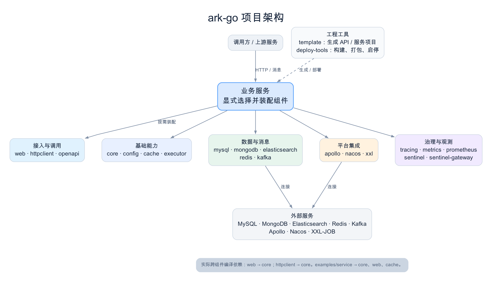

# ark-go

`ark-go` 是一套企业级 Go 基础组件仓库，提供 HTTP、配置、缓存、数据访问、消息、服务治理和可观测性等能力。当前仓库有 **22 个独立组件 module**，另有一个独立的示例服务 module。业务服务根据需要显式创建和装配组件。

## 架构



每个一级组件目录都有自己的 `go.mod`，module 路径为 `github.com/lijizhong480/ark-go/<组件名>`。根目录没有 `go.mod`；`go.work` 用于仓库内开发和联调。图中的连线表示业务服务的按需装配及外部系统连接，并不表示所有组件都由一个服务同时启用。

目前实际的跨组件编译依赖是 `web → core` 和 `httpclient → core`。组件间的配置、指标和治理能力主要由业务服务通过接口或回调接入。`examples/service` 展示了 `core`、`web`、`cache` 的组合。

| 类别 | 组件 | 主要职责 |
| --- | --- | --- |
| 基础能力 | `core`、`config`、`cache`、`executor` | 生命周期与响应契约、配置源、本地缓存、有界执行池 |
| 接入与调用 | `web`、`httpclient`、`openapi` | HTTP 中间件、出站调用、OpenAPI 文档 |
| 数据与消息 | `mysql`、`mongodb`、`elasticsearch`、`redis`、`kafka` | 数据源与客户端、消息生产消费 |
| 平台集成 | `apollo`、`nacos`、`xxl` | 动态配置、服务发现、XXL-JOB 执行器 |
| 治理与观测 | `tracing`、`metrics`、`prometheus`、`sentinel`、`sentinel-gateway` | 链路传播、指标、限流与网关规则 |
| 工程工具 | `template`、`deploy-tools` | 生成 API/服务项目，以及构建、打包、启停服务 |

## 快速开始

建议使用 **Go 1.23 或更高版本**。在仓库根目录运行全部组件及示例的测试：

```bash
bash scripts/test-all.sh
```

根目录不是 Go module，因此测试脚本会逐个进入组件目录执行 `go test ./...`。只测试示例服务可运行：

```bash
cd examples/service
go test ./...
```

生成一套独立的 API 与服务项目：

```bash
cd template
go run ./cmd/arkgen -name order -module-prefix example.com/team -output /tmp/order
```

生成的项目包含 `order-api`、`order-svr` 和用于本地联调的 `go.work`。`template/README.md` 说明生成物，`deploy-tools/README.md` 说明构建、打包和启停命令。各组件的用法与兼容边界见对应目录下的 README。

## 使用与发布边界

- `web`、`httpclient` 等跨组件依赖仍使用 `v0.0.0` 占位版本，并由本地 `go.work` 解析；在仓库外独立引用前，需要发布真实的组件版本。
- 组件测试覆盖当前代码中的构建和行为契约。Redis、Kafka、MongoDB、MySQL、Elasticsearch、Apollo、Nacos、XXL-JOB 等外部系统的实际部署环境及跨语言兼容性仍需按业务场景联调。
- `template` 和 `deploy-tools` 是工程工具，不是业务服务的运行时依赖。

架构图可通过 `dot -Tpng -Gdpi=160 docs/architecture.dot -o docs/architecture.png` 重新生成。
